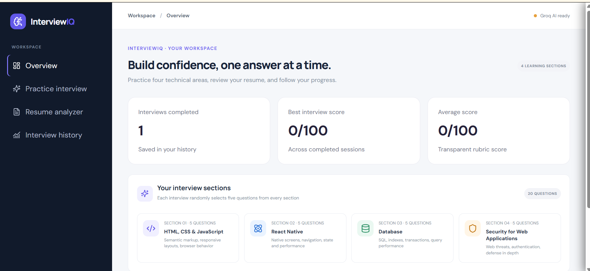
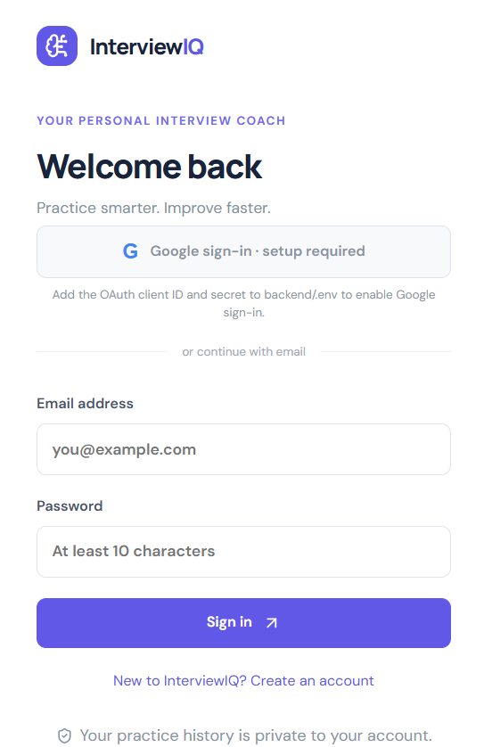

# InterviewIQ by R k Jha

**InterviewIQ** is an AI-assisted technical interview platform with four role tracks, voice capture, AI-generated questions, rubric-based answer evaluation, and resume feedback.

## Overview

The app uses the Groq Chat Completions API for candidate-aware interview question generation, per-answer technical evaluation with cited evidence, and resume coaching. Each interview draws five topics per section from the 300-question topic bank, then the model authors a tailored prompt for each selected topic. Scores use a fixed 100-point rubric and are guidance for human review, not automated hiring decisions. Voice capture and playback use browser speech services; camera video stays local and is not recorded.

The live model features require a Groq API key and an enabled API account. Without that credential, AI operations intentionally return a configuration error rather than substituting a mock score. This repository is an application implementation, not a certified hiring assessment or a security-audited production deployment.

## Technology

- Frontend: React 18, Vite, React Router, Lucide icons, responsive CSS.
- Backend: Python, FastAPI, Pydantic, SQLAlchemy, JWT, Argon2 password hashing, PyMuPDF.
- Database: SQLite by default; SQLAlchemy URL can be configured for PostgreSQL.

## Architecture and structure

The React app calls the JSON API under `/api`. FastAPI authenticates private endpoints and scopes session queries to the account owner. Interview sessions store candidate details, extracted resume text, speech transcripts, and AI scores until the owner deletes the session. Resume analyzer requests are processed in memory and not retained by that endpoint. Candidate resume and answer text are sent to Groq with structured-output constraints.

```text
frontend/src/       React interface and styles
backend/app/main.py FastAPI app, models, routes, validation
backend/tests/      API smoke tests
docs/               Project synopsis and schema overview
```

## Windows setup

Open two PowerShell terminals in the project folder.

### Backend

```powershell
cd backend
py -m venv .venv
.venv\Scripts\Activate.ps1
python -m pip install -r requirements.txt
Copy-Item ..\.env.example .env
```

Set a private random `JWT_SECRET` and a valid `GROQ_API_KEY` in `backend/.env` before creating accounts or using AI features. The settings loader reads `.env` from the backend working directory. The Groq Free Plan has per-model usage limits; requests return a retryable error when a limit is reached and this app does not switch to a paid provider. Then run:

```powershell
uvicorn app.main:app --reload --port 8000
```

Swagger UI is at `http://localhost:8000/docs`; health check is `/api/health`. SQLite creates `backend/interviewiq.db` on startup. For PostgreSQL, set `DATABASE_URL` to a SQLAlchemy PostgreSQL URL and install a compatible PostgreSQL driver.

### Frontend

```powershell
cd frontend
npm install
npm run dev
```

Open `http://127.0.0.1:5173`. The default API URL is `http://localhost:8000/api`; if it differs, set `VITE_API_URL` in `frontend/.env` (the variable is documented in the root `.env.example`). The backend CORS allowlist defaults to `http://127.0.0.1:5173`; configure `FRONTEND_ORIGIN` for another explicit origin.

## Configuration

Copy `.env.example` to `backend/.env`, set a private random `JWT_SECRET`, and configure `AI_PROVIDER=groq`, `GROQ_API_KEY`, and `AI_MODEL=openai/gpt-oss-120b`. Keep this key on the backend only; never add it to frontend environment variables or commit it. Restart the backend after configuration. AI interview creation, answer scoring, and resume analysis return HTTP 503 until a key is configured. Resume PDFs are limited by `MAX_UPLOAD_MB`; scanned PDFs require OCR before analysis.

## Google sign-in setup

Google sign-in stays disabled until OAuth credentials are added to `backend/.env`. In Google Cloud Console, create an OAuth client with application type **Web application** and set:

- Authorized JavaScript origin: `http://127.0.0.1:5173`
- Authorized redirect URI: `http://localhost:8000/api/auth/google/callback`

Copy the client ID and secret into `GOOGLE_CLIENT_ID` and `GOOGLE_CLIENT_SECRET`; keep the secret in the backend environment only. Set `GOOGLE_REDIRECT_URI` to the exact redirect URI above. Restart the backend after changing `.env`. If the OAuth consent screen is in testing mode, add the Google account you will use as a test user. The flow checks OAuth state, verifies Google's signed ID token and verified email, and requests only `openid email profile`; Google access tokens are not retained. Follow [Google's web server OAuth guide](https://developers.google.com/identity/protocols/oauth2/web-server) for console setup and deployment guidance.

## API currently implemented

| Method | Path | Purpose |
|---|---|---|
| POST | `/api/auth/register` | Create account and return bearer token |
| POST | `/api/auth/login` | Authenticate using form-encoded credentials |
| GET | `/api/auth/me` | Current account |
| POST | `/api/interviews` | Generate a role-specific question with the configured model |
| GET | `/api/interviews` | List own interview records |
| GET | `/api/interviews/{id}` | Read an owned record |
| POST | `/api/interviews/{id}/answers` | Save answer and AI rubric evaluation |
| GET | `/api/interviews/{id}/report` | Retrieve saved report for an owned interview |
| GET | `/api/interviews/{id}/report/pdf` | Download report PDF |
| DELETE | `/api/interviews/{id}` | Delete own record |
| GET | `/api/dashboard/summary` | Totals and recent records from database |
| POST | `/api/voice-interviews` | Generate and save a four-section, 20-question AI interview |
| GET | `/api/voice-interviews` | List the signed-in account's sessions and scores |
| POST | `/api/voice-interviews/{id}/answers` | AI-evaluate a voice transcript against the fixed rubric |
| DELETE | `/api/voice-interviews/{id}` | Delete an owned session, resume text, answers, and score |
| POST | `/api/resumes/analyze` | Analyze an uploaded PDF with the configured AI model |
| POST | `/api/resumes/extract` | Validate PDF and return extracted text preview |
| GET | `/api/health` | Health and configured provider label |

## Tests

From `backend`, activate the virtual environment and run `pytest`. The included tests cover health/provider labeling, unauthenticated access rejection, registration and answer submission, rubric shape, report and PDF generation, invalid credentials, ownership isolation, and invalid upload MIME. They are smoke tests, not the comprehensive security and provider failure-mode suite requested in the project brief.

## Security and privacy notes

Passwords are Argon2-hashed. JWTs are stored in browser local storage. Private interview lookups are filtered by user ID and return 404 for unavailable records. Interview resume text and transcripts remain in session history until the user deletes the record; the analyzer does not retain its upload. Use HTTPS, secure cookie sessions, managed secrets, database migrations, rate limiting, audit logging, backup/retention policies, and independent security review before company-wide use. This codebase is not yet a security-audited enterprise hiring system.

## Database overview

`users` stores unique email and password hash. `interviews` references its owner and stores role, difficulty, generated local question, answer, percentage score, per-category rubric JSON, feedback, strengths, suggestions, model-answer outline, and timestamp. Schema creation currently uses SQLAlchemy metadata at application startup; Alembic migration scripts are not included yet.

## Screenshots

<table>
  <tr>
    <th>Home Page</th>
    <th>Interview Dashboard</th>
  </tr>
  <tr>
    <td>
      
    </td>
    <td>
      
    </td>
  </tr>
</table>

## Deployment and future work

Run locally using the setup above after adding the provider key. Before a company-wide or hiring-critical deployment, add managed PostgreSQL and Alembic migrations, secure cookie sessions, distributed rate limiting, audit logging, model cost limits and observability, retention controls, accessibility review, security testing, and calibrated human-reviewed scoring. Do not use model scores as the sole hiring decision.

## B.Tech synopsis outline

See [docs/project-synopsis.md](docs/project-synopsis.md) for a synopsis outline suitable for adapting to departmental format.
